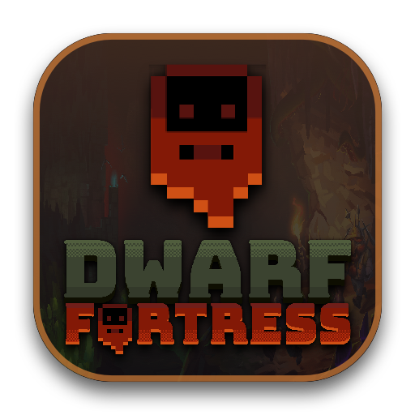

<p align="center">
  
</p>

<h1 align="center">Dwarf Fortress Mac Launcher</h1>

<p align="center">
  <strong>Native macOS GUI Launcher for Dwarf Fortress (Classic & Steam Edition) on Apple Silicon & Intel Macs</strong><br/>
  Auto-detects & installs Rosetta 2 + Wine 11.21 · 1-Click DFHack · Workshop Mod Manager · DFCN Localization
</p>

<p align="center">
  <a href="README.md">English</a> · <a href="README_ZH.md">简体中文</a> · <a href="https://github.com/zxypro1/df-mac-launcher/releases">Releases</a>
</p>

---

## ✨ Features

- **Universal Apple Silicon & Intel Support**: Native Universal Binary (`arm64` + `x86_64`) adapting to all Apple M-series chips (`M1` / `M2` / `M3` / `M4` Base, Pro, Max, Ultra) and Intel Macs.
- **Zero Pre-installed Dependencies**: Automatically detects whether **Rosetta 2**, **Wine 11.21 (Metal/MoltenVK)**, and the **64-bit Wine Prefix** are installed, and downloads/initializes them inside the app with one click.
- **Classic & Steam Edition (`AppID 975370`)**:
  - Plug in any local Classic or Steam Dwarf Fortress directory.
  - Built-in **1-Click Steam Console Depot Downloader** (`download_depot 975370 975371`) and **SteamCMD (with 5-digit Steam Guard code)** integration.
- **Native DFHack Integration**:
  - 1-click download, installation, and toggle for **DFHack** (`dfhooks_dfhack.ini` -> `hack/dfhooks_dfhack.dll`).
  - Visual toggles for popular startup plugins (`autolabor`, `autofarm`, `autobutcher`, `autochop`, `tailor`, `prioritize`, `fastdwarf`, `stonesense`) and built-in `dfhack.init` script editor.
- **Mod & Steam Workshop Manager**:
  - Import local `.zip` or folder mods directly into `mods/`.
  - 1-click sync from local Steam Workshop (`steamapps/workshop/content/975370`) with automatic conflict protection.
- **1-Click Chinese Localization (DFCN)**:
  - Co-exists seamlessly with DFHack via Dwarf Fortress 53.16's native `dfhooks.dll` multiplexer (`dfhooks_dfcn.ini`).
- **Bilingual UI**: English by default, with an instant `EN / 中文` toggle in the header bar.

---

## 🚀 Installation & Quick Start

1. Download the latest **`Dwarf_Fortress_Launcher_Mac.dmg`** from [Releases](https://github.com/zxypro1/df-mac-launcher/releases).
2. Open the `.dmg` and drag **`Dwarf Fortress Launcher.app`** to **`/Applications`**.
3. If macOS Gatekeeper prompts that the app is unsigned, double-click **`Fix_Gatekeeper_First_Launch.command`** inside the DMG (or run `xattr -cr "/Applications/Dwarf Fortress Launcher.app"`).
4. Open **Dwarf Fortress Launcher**:
   - Click **Auto-Install Runtime** (or click **Setup Runtime & Launch**) — the launcher will automatically install Rosetta 2, download Wine 11.21, and initialize the Wine container.
   - Select your local **Classic** or **Steam** Dwarf Fortress folder (or download the Steam edition directly from the **Steam** tab).
   - Enable **DFHack**, configure your mods, and click **Launch Dwarf Fortress**!

---

## 🛠️ Build from Source

Requires macOS 14.0+ and Xcode Command Line Tools (`xcode-select --install`).

```zsh
git clone https://github.com/zxypro1/df-mac-launcher.git
cd df-mac-launcher

# Build Universal .app and .dmg into ./dist
zsh src/build_dmg.sh ./dist
```

---

## 📄 License

Released under the [MIT License](LICENSE).
