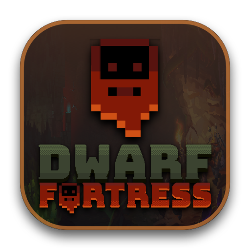

<p align="center">
  
</p>

<h1 align="center">Dwarf Fortress Mac Launcher (矮人要塞 Mac 启动器)</h1>

<p align="center">
  <strong>专为 Apple Silicon (M1~M4 全系芯片) 与 Intel Mac 打造的《矮人要塞》原生图形启动器</strong><br/>
  零预装自动配置 Rosetta 2 + Wine 11.21 · 一键安装 DFHack · 创意工坊 Mod 同步 · DFCN 简体中文汉化
</p>

<p align="center">
  <a href="README.md">English</a> · <a href="README_ZH.md">简体中文</a> · <a href="https://github.com/zxypro1/df-mac-launcher/releases">下载 Releases</a>
</p>

---

## ✨ 核心特性

- **全系 Apple M 芯片与 Intel 通用架构**：原生编译 `arm64 + x86_64` Universal Binary，自动识别当前 Mac 芯片型号。
- **零预装环境假设 · 全自动检测与安装**：首次启动自动检测 **Rosetta 2**、**Wine 11.21 (Metal/MoltenVK)** 与 **64 位容器注册表**；缺失时可在应用内一键自动下载并完成初始化。
- **双版本无缝支持（Classic 独立版 & Steam 版 `975370`）**：
  - 支持自由选择接入本地已有的 Classic 版或 Steam 版游戏目录。
  - 内置 **Steam 控制台免登录一键下载**（自动唤起 `steam://open/console` 并复制 `download_depot 975370 975371`）与 **SteamCMD（支持 5 位令牌码直连）**。
- **原生集成 DFHack 插件中心**：
  - 一键在线下载、安装、修复或独立开关 **DFHack**（通过 `dfhooks_dfhack.ini` 挂载）。
  - 提供常用插件（自动劳工 `autolabor`、智能农田 `autofarm`、自动屠宰 `autobutcher`、3D 渲染 `stonesense` 等）可视化自启开关及 `dfhack.init` 脚本编辑器。
- **DFCN 简体中文汉化完美共存**：
  - 利用 DF 53.16+ 原生 `dfhooks.dll` 多路复用机制，实现 **DFHack + DFCN 中文汉化** 同时加载且互不冲突，支持在线一键下载安装汉化。
- **Mod 与 Steam 创意工坊管理**：
  - 支持直接导入 `.zip` 压缩包或文件夹 Mod，或从本机 Steam 创意工坊目录一键同步。
- **中英双语界面**：默认英文（`EN`），可在顶部导航栏一键切换为 `中文`。

---

## 🚀 安装与使用

1. 前往 [Releases](https://github.com/zxypro1/df-mac-launcher/releases) 下载最新 **`Dwarf_Fortress_Launcher_Mac.dmg`**。
2. 双击挂载 `.dmg`，将 **`Dwarf Fortress Launcher.app`** 拖入 **`Applications`（应用程序）**。
3. 若首次打开提示未签名，双击镜像内的 **`Fix_Gatekeeper_First_Launch.command`**（或在终端执行 `xattr -cr "/Applications/Dwarf Fortress Launcher.app"`）。
4. 打开启动器（右上角可切换 `EN` / `中文`）：
   - 点击「**一键安装环境**」，启动器会自动为您安装 Rosetta 2、下载 Wine 11.21 并初始化容器。
   - 点击「**选择目录...**」绑定您的游戏目录（或切换到 Steam 版直接下载）。
   - 勾选开启 **DFHack** 与 **DFCN 中文汉化**，点击「**启动 Dwarf Fortress**」即可畅玩！

---

## 🛠️ 从源码编译

需要 macOS 14.0+ 及 Xcode Command Line Tools (`xcode-select --install`)：

```zsh
git clone https://github.com/zxypro1/df-mac-launcher.git
cd df-mac-launcher

# 编译通用架构 .app 并打包生成 .dmg 到 ./dist 目录
zsh src/build_dmg.sh ./dist
```

---

## 📄 开源协议

基于 [MIT License](LICENSE) 开源。
